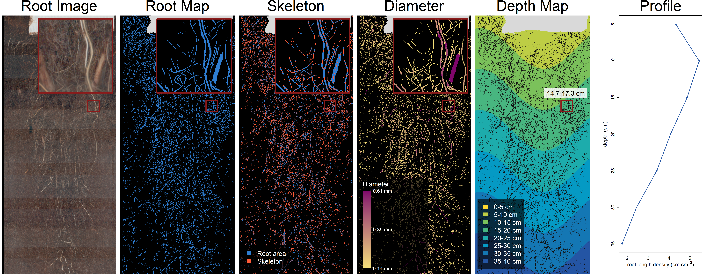

```{r setup, include = FALSE}
knitr::opts_chunk$set(collapse = TRUE, comment = "#>",
                      warning = FALSE, message = FALSE,
                      dpi = 150, fig.width = 9)

# Base graphics default to wide margins, which at this figure size is mostly
# empty page. terra::plot() sets its own, so those calls pass mar = themselves.
knitr::knit_hooks$set(tight = function(before, options, envir)
  if (before) graphics::par(mar = c(4, 4, 1.6, 0.6)))
knitr::opts_chunk$set(tight = TRUE)
library(Rootopia)
library(terra)
```

# Introduction

How deep a root system reaches decides what it can get at. Water and nitrate
move down through a profile and are lost from the top of it, phosphorus stays
where it is, and carbon deposited below the plow layer persists longer than
carbon deposited above it, so the same total root length means different things
depending on the depth it occupies (Freschet *et al.* 2021). A trait reported
as one number per image averages exactly that away.

Roots are buried, and the two standard ways of imaging them each give up
something. A flatbed scanner captures washed roots at high resolution under
controlled light, which gives morphology but destroys the plant and loses the
depth each root grew at. A minirhizotron keeps both the plant and the depth, by
imaging soil through the wall of a transparent tube -- but it returns that
tube's unrolled curved surface as a flat strip, in which pixel position is not
depth. Depth has to be reconstructed from the tube's diameter, its insertion
angle and the scan resolution before any trait can be attributed to a horizon.

Finding the roots in either image is a segmentation problem, and trained models
solve it well enough to be used as given --- RootDetector (Peters *et al.*
2023) and RootPainter (Smith *et al.* 2022) are two of them, and where the
examples here came from.
What they return is a mask. Turning that mask into root length density per 5 cm
interval is not recognition but geometry, and it is the step at which a depth
axis is either earned from measured quantities or quietly invented.

Rootopia performs that conversion and measures the traits that follow from it:
root length, diameter, surface, branching architecture, network topology,
turnover between sessions, and soil color and texture -- each per depth
interval wherever a depth map exists. The boundary matters in both directions:

* **Segmentation is somebody else's job.** `image_threshold()` is the one
  segmenter here, and it is the simplest kind: it splits foreground from
  background by brightness alone, in either direction. That is enough for
  washed roots on a tray of known color and not enough for roots in soil,
  where wet soil, old root and debris overlap in brightness. A trained model
  does that job, and handing over to one is a step in the workflow rather than
  an optional extra.
* **Depth is computed, not assumed.** It comes from the tube geometry and the
  scan resolution, which are numbers you supply; length estimators are named
  rather than chosen for you; and every function states which image type it
  expects.

This chapter covers the three image types and what consumes them, one complete
worked depth profile, and each remaining module in turn. Part I is the standard
minirhizotron workflow from stitched frames to a depth profile, Part II the
modules that attach to it, and Part III the flatbed case, which has no depth
axis and goes to architecture instead.

## The two pathways

The package covers two imaging setups that share a front end and diverge after
it. A minirhizotron sequence is stitched, segmented, and then reduced to traits
per depth interval. A flatbed scan has no depth axis, so it goes to
architecture instead: branch order, network shape, transport. Only stitching
and segmentation are common to both, and segmentation happens outside this
package.

Three things sit beside both paths rather than in either. **Root angle** needs
a depth map and a skeleton together. **Soil color and texture** read the RGB
scan and never touch root shape. **Turnover** compares two sessions. Part II
takes each in turn.

Branch order belongs to the flatbed side. Nothing stops you running it on a
tube scan, and `branch_order_map()` will return a graph -- but a minirhizotron
frame is a window onto a cylinder, so a root leaves and re-enters the field of
view and the topology you recover is the topology of the visible fragments, not
of the root system. Order and network metrics mean what they say on a washed
root system laid flat.

**On cleaning.** `clean_image()` is optional on both sides but not neutral.
`drop_objects_upto` removes connected components below a pixel count, which
deletes scanner speckle and also deletes genuine fine-root fragments that enter
and leave the frame -- on a minirhizotron scan those fragments are real root.
`fill_holes_upto` closes pinholes inside a mask, which raises area and lowers
the measured diameter variance. Neither is reversible downstream, so the
honest order is: measure once without cleaning, once with, and report which you
used. For branch order the calculation is different -- specks become spurious
one-segment components and pinholes become spurious loops -- so there cleaning
earns its place.

`root_depth_metrics()` is not a step in either column. It is a batch wrapper
that runs the whole left-hand path over a folder of images.

Two patterns cover everything downstream of the depth map, and both appear
below. A trait that reduces to a per-zone sum or mean goes through
`terra::zonal()` in one call. A trait whose function needs a whole image goes
through `depth_zoning()`, which crops the image to one interval, in a loop.

```{r logo, echo = FALSE, out.width = "30%", fig.align = "center", eval = knitr::is_latex_output() && file.exists("logo.png"), fig.cap = "The Rootopia hex logo, designed by Kaisa Jukuri.", fig.alt = "The Rootopia hex logo."}

```

```{=latex}
\newpage
```

# Part I: the standard minirhizotron workflow

This is the path almost every minirhizotron analysis takes, in order: censor
the rotation, build a depth map, bin it, measure traits per bin, summarize the
profile. Nothing is thinned on the fly here: the example has a skeleton from
the segmenter, so the hand-over described above is exercised as it stands. Where
a segmenter returns no skeleton, one step is added and the section below shows
what it costs. Part II then adds the modules that sit outside this path.

## Stitch the frames, if there are several

Before anything else: a tube is often imaged as several overlapping frames, and
a root crossing a frame boundary would otherwise be measured twice. If each
tube is already one image, skip this. `stitch_root_scans()` groups files into
tubes by a pattern in the filename, aligns consecutive frames over a band along
the overlapping edge, and blends them into one mosaic per tube. Alignment is
FFT phase correlation (`method = "phase"`); `method = "feature"` is accepted
but stops with a message, because keypoint matching has no backend here.

Two arguments decide which files are read and how they are grouped, and they
do different jobs. `pattern` is a plain substring that keeps or drops whole
files; `group_regex` is the expression that pulls the tube identity out of each
path. The default `group_regex` is already `"T0\\d{2}"`, which matches labels
like `T067`, so a naming scheme built on `T0xx` needs nothing set. Anything
else does: a folder named by plot and tube would use something like
`group_regex = "P\\d+_T\\d+"`.

```{r stitch, eval = FALSE}
# See what a folder holds, then pick a range in the same call
stitch_root_scans("path/to/scans", tubes = "ask")

res <- stitch_root_scans(
  "path/to/scans",
  pattern     = ".tiff",        # read only these files
  group_regex = "T0\\d{2}",      # the tube identity inside each file name
  blend       = "max",          # see below: do not average a segmented mask
  order_by    = "\\d+(?=\\.)",   # sort frames on their number, not the file name
  report      = TRUE
)
res$report      # tube | step | dx | dy | peak | overlap
```

The report has one row per join. `peak` is how strongly the two edge bands
agree at the shift that was chosen: a normalized correlation score, near 1 when
the overlap matched cleanly and near 0 when the alignment is little better than
a guess. It is the column to check, because a bad join does not announce
itself -- the mosaic is still produced, with a seam in the wrong place.

```{r stitch-peak, eval = FALSE}
# The ten least trustworthy joins in the run, worst first.
res$report[order(res$report$peak), ][1:10, ]
```

If a mosaic looks wrong, three arguments are worth changing before anything
else. `edge_width` is the width of the band searched for the overlap, not the
overlap itself, so it must be at least as wide as the true overlap -- an
overlap wider than the band cannot be found at all. `preprocess` conditions the
bands before correlation: `"hann"`, `"grad"` or `"center"` help on scans with
uneven lighting or sparse texture, where plain intensity correlation locks onto
the illumination gradient instead of the roots. And `min_overlap` /
`max_overlap` reject a shift that is physically impossible for your setup,
which is the cheapest way to stop one bad join from propagating.

`blend` decides how the overlap is combined, and the choice is not cosmetic.
`"linear"` feathers the two frames with an alpha ramp, which suits color scans.
For a segmented mask use `"max"`: feathering *averages*, so a root pixel in one
frame and background in the other becomes a fractional value, and thin roots
ghost wherever alignment is off by a pixel. `"max"` takes the union instead, so
a pixel is root if either frame called it root. `"overlay"` and
`"overlay_first"` let one frame hide the other outright, and `"min"` takes the
intersection, which erodes rather than ghosts.

## Hand the images to a segmenter

Stitched or not, the next step is not in this package. A scan has to be turned
into a root mask. Any tool that writes a binary mask will do; two that are used
on minirhizotron images are:

* **RootDetector** (Peters *et al.* 2023) --- a convolutional network. Returns
  the segmentation and a skeleton in one pass, and optionally the
  decay/production/constant coding that `root_turnover(method = "dpc")` reads.
* **RootPainter** (Smith *et al.* 2022) --- interactive training, where you
  correct the model as it learns. Returns a mask, and no skeleton.

Those are examples, not requirements, and nothing below depends on either.
Rootopia reads PNG, JPEG, TIFF, BMP, `terra` and `raster` objects, `imager`
images and plain arrays, so the format is rarely the obstacle. What matters is
which of the image types below you get back, not which program produced them.

Only one case does not need a trained model: a scan where root and background
differ in brightness alone. `image_threshold()` compares each pixel against
either a fraction of the image maximum (`method = "global"`) or a multiple of a
local mean (`method = "adaptive"`). By default it keeps the pixels at or above
that level, so the **bright** side is the foreground, which fits roots on a
dark tray. A flatbed scan is normally the reverse, dark roots on a bright tray,
and `invert = TRUE` moves the cut to the other side of the pixel value:

```{r threshold-invert, eval = FALSE}
# Dark roots on a bright tray.
image_threshold(scan, threshold = 0.4, method = "global",
                binary_01 = TRUE, invert = TRUE)

# The adaptive form then asks that a pixel be adaptive_k times darker than its
# surroundings, rather than that much brighter.
image_threshold(scan, method = "adaptive", adaptive_k = 1.15,
                window_size = 51, binary_01 = TRUE, invert = TRUE)
```

This works only where brightness alone separates root from background, which
in practice means washed roots on a tray of known color. It does not work on a
minirhizotron scan: wet soil, old root and organic debris overlap in brightness
there, so no single cut and no local multiplier puts a boundary between them,
whichever side you keep. That is a property of the image, not a shortcoming of
the function, and it is why the hand-over to a trained segmenter is the step
above rather than an optional extra.

What comes back is one or more image layers per scan. Which ones depends on the
segmenter, and the three the rest of this article uses are described next.

## The image layers, and which is which

A segmenter returns one or more image layers per scan, and they are not
interchangeable. How many depends on the tool: a mask is the one you always
get, a skeleton comes from some segmenters and not others, and the color
photograph survives only if the setup recorded it. The three used below are the
three a RootDetector run happens to produce, which is why the bundled example
has all of them.

Figures here use `zoom_plot()`, as the step-by-step vignettes do. These rasters
are several thousand pixels wide, and shrinking one to fit a figure makes the
graphics device drop the one-pixel-wide roots entirely; `zoom_plot()` draws a
full-image overview with the magnified region outlined, plus that region at
native resolution where thin features survive. `frac` sets the inset size, so
the magnification is `1 / frac`.

```{r load}
# Three layers from one RootDetector run on one tube; layer 2 carries the roots.
data(seg_Oulanka2023_Session03_T067)
data(skl_Oulanka2023_Session03_T067)
data(rgb_Oulanka2023_Session03_T067)

dpi <- 150   # the scan resolution; every cm value below depends on it

# Keep the full 3-band image (0/255) for the mask and depth steps below.
seg_img <- load_flexible_image(seg_Oulanka2023_Session03_T067,
                               output_format = "spatrast", scale = "none")

# load_flexible_image() also selects the root channel and binarizes it to 0/1
# in one call, so pixel sums and the void mask (abs(root_layer - 1)) are
# meaningful.
root_layer <- load_flexible_image(seg_Oulanka2023_Session03_T067,
                                  output_format = "spatrast",
                                  scale = "binary", select_layer = 2)

# The one-pixel center line, as this segmenter supplies it.
skl <- load_flexible_image(skl_Oulanka2023_Session03_T067,
                           output_format = "spatrast",
                           scale = "binary", select_layer = 2)

# The color functions read the photograph as it comes; drawing it wants 0-1.
# `scale` does both conversions, so neither is done by hand.
rgb      <- load_flexible_image(rgb_Oulanka2023_Session03_T067,
                                output_format = "spatrast", scale = "none")
rgb_disp <- load_flexible_image(rgb_Oulanka2023_Session03_T067,
                                output_format = "spatrast", scale = "to_01")
```

Each carries different information, so each feeds different functions.

| Image | What it is | What it is for |
|---|---|---|
| RGB | the photograph | color, texture, soil class |
| Segmentation | solid root mask, 0/1 | area, diameter, cleaning |
| Skeleton | one-pixel center line | length, tips, branching, root angle |

Only the mask is guaranteed. Where no skeleton comes back,
`skeletonize_image()` thins the mask into one, so a missing skeleton is never a
blocker -- but a supplied skeleton and a thinned one are not the same picture,
and the section below compares them before anything downstream uses either.

## Which image feeds which function

This is the table to keep. Passing the wrong type usually gives a wrong number
rather than an error.

| Function | Needs | Note |
|---|---|---|
| `count_pixels()` | segmentation | area, not length |
| `root_length()` | skeleton | `skeletonize = TRUE` thins a mask first |
| `branch_order_map()` | **both** | also where tips and forks come from |
| `root_diameter()` | **both** | mask for widths, skeleton for where |
| `network_metrics()` | segment table | from `branch_order_map()$edges` |
| `root_transport()` | segment table | needs diameters, so needs `mask =` |
| `root_scape_metrics()` | segmentation | patch structure of solid root (needs **landscapemetrics**) |
| `create_depthmap()` | any raster | reads the grid, not the values |
| `tube_coloration()` | RGB | three bands required |
| `classify_soil_rgb()` | RGB | per-pixel material class |
| `analyze_soil_texture()` | RGB | GLCM texture (needs **glcm**) |
| `root_turnover()` | two scans, or one DPC | per `tc_method` |

Throughout this article **mask** means the segmentation: the solid 0/1 image in
which every root pixel is 1. It is what the `mask =` argument of the branching
functions and the first argument of `root_diameter()` expect.

**`root_diameter()` is the one to understand.** Diameter comes from a distance
transform of that solid image: every root pixel is labeled with its distance to
the nearest background pixel, which is the radius of the largest circle that
fits inside the root there, and diameter is twice that. The skeleton then says
*which* of those pixels to report, so each root contributes its center line once
rather than its whole width. Pass only a skeleton and every diameter collapses
to about one pixel. The same applies to `mask =` in the branching functions,
where the continuation rule and the order-1 seed both depend on diameter.

`select_layer` applies to that first argument only, not to `skeleton_img`. It
picks the band to read when the mask arrives as a multi-layer image; `NULL`
passes every layer through, which is right when the mask is already one band,
as `root_layer` is here.

## Censor the rotation

A tube can turn between sessions, and the scanner does not cover a full circle,
so roots near the edge of the scan are visible in one session and not the next.
Left alone that is a systematic bias which looks like growth or death. Cropping
every session to a common window of rows removes it, and it is standard
procedure rather than an option.

```{r censor, fig.alt = "The full scan with the retained window outlined in green and the discarded margins shaded red."}
# The window has to be centered on the tube's rotational zero, and that is a
# per-scan quantity: estimate_rotation_center() locates it from the tape on the
# tube's upper side, and estimate_rotation_shift() measures how far a later
# session has turned relative to the first, which is what you add to the first
# session's center. Both need RStoolbox and imagefx, so the midpoint stands in
# here to keep this article runnable on a thin install.
r0 <- round(dim(root_layer)[1] / 2, 0)

censored <- rotation_censor(
  root_layer,
  center_offset  = r0,
  cut_buffer     = 0.02,
  fixed_width    = 900,    # rows kept; must fit inside the image height
  fixed_rotation = TRUE,   # equal width across sessions is what makes
  overlay        = TRUE,   # counts comparable
  main = "Rotation censor: kept (green) vs cut (red)"
)
```

`fixed_rotation = TRUE` forces exactly `fixed_width` rows, which is what you
want when comparing sessions: equal width is what makes counts comparable.
`fixed_rotation = FALSE` instead cuts in proportion to a measured offset, so
the output width varies between images.
In a real run the order is: `estimate_rotation_center()` once per tube on the
first session, `estimate_rotation_shift()` for every later session against it,
and the sum passed as `center_offset` so the same band of tube is kept
throughout. `center_offset` is a row index here; it is a fraction of the image
height only in `create_depthmap()`, which is a different argument with the same
name.

The rest of this article works on the uncensored image, so the depth figures
cover the whole scan -- which is still less than a full turn of the tube, since
the scanner does not reach all the way around.

## The skeleton: supplied, or made here

Some segmenters return a skeleton along with the mask; others return only the
mask. Both cases work. Where a skeleton comes back, use it. Where it does not,
`skeletonize_image()` thins the segmentation into one: it strips pixels off the
edges of each root, layer by layer, until a single connected line of pixels is
left down the middle, which is the Zhang-Suen thinning.

The two are not the same picture, and the difference is not noise. A thinned
skeleton follows the segmentation exactly, so a pinhole in the mask becomes a
small loop and a ragged edge can grow a short spur that is not a root. A
segmenter that predicts the center line directly is not bound by the mask it
also predicts, so it can disagree with its own mask.

That difference is worth looking at on your own scans, and it cannot honestly
be shown on the example data here, which is downsampled to keep the package
installable. `data-raw/make-figures.R` draws it from full-resolution originals:
fill in the two paths at the top and run it, and the figure appears below.

```{r skeleton-compare-file, echo = FALSE, out.width = "100%", eval = file.exists("figures/skeleton_compare.png"), fig.alt = "A magnified window of one scan showing where a supplied skeleton and a skeleton thinned from the same mask agree and where each has pixels the other does not."}
knitr::include_graphics("figures/skeleton_compare.png")
```

```{r skeleton-compare-missing, echo = FALSE, results = "asis", eval = !file.exists("figures/skeleton_compare.png")}
cat("*No comparison figure found. `data-raw/make-figures.R` writes one;",
    "fill in the two scan paths at the top of that script and run it.*\n")
```

Whichever you use, use one consistently. Mixing a supplied skeleton in one
session with a thinned one in the next puts a step into a time series that has
nothing to do with roots. Everything below uses the supplied skeleton.

## Root diameter

Diameter needs both images at once: the mask gives the width, the skeleton says
which pixels to report. `root_diameter()` returns the local thickness across
the whole scan as well as the per-skeleton-pixel diameters, so it is worth
looking at before reducing it to a per-interval mean.

```{r diameter, fig.alt = c("Local root thickness across the whole scan, with the magnified region outlined.", "The same thickness map magnified to native resolution.")}
diam_result <- root_diameter(
  root_layer,
  skeleton_img = skl,
  unit         = "cm",
  dpi          = dpi,   # not optional: the default is 300
  select_layer = NULL
)

# root thickness
zoom_plot(diam_result$distance_map_rast, frac = 0.1)
```

## From pixels to depth

### The depth map

```{r depthmap, fig.alt = "Depth map in centimeters, shading from shallow at one end of the tube to deep at the other."}
depth_map <- create_depthmap(
  img                 = root_layer,
  geometry            = "tube",  # "window" planar, "flat" no depth axis
  tube_thicc          = 7,       # cm - measure your own tube
  angle_from_vertical = 45,      # degrees from vertical; 0 is upright
  dpi                 = dpi,
  start_soil          = 2.9,     # cm - from in-situ calibration
  center_offset       = 0.5      # tube top halfway down the image
)

terra::plot(depth_map, main = "Depth map (cm)")
```

Every argument above except `geometry` is a measurement, taken on the tube or
read off the scanner, and each one fails in its own way if it is wrong.

* `angle_from_vertical` --- the installation angle, in degrees from vertical,
  so 0 is an upright tube and 90 a horizontal one. From the field notes.
* `tube_thicc` --- the inner diameter in centimeters, measured on the tube. If
  it or `dpi` is wrong the curvature wave cannot span the image height and the
  function stops with `Wrong Tube Diameter`, which is the one error here that
  catches itself.
* `dpi` --- the scan resolution, from the scanner settings. Every centimeter
  in this article depends on it.
* `start_soil` --- where the soil surface sits along the tube, in centimeters,
  from in-situ calibration. It is subtracted from every depth, so an error
  shifts the whole profile by that amount and changes nothing else.
  `estimate_soil_surface()` estimates it from the image in pixels; convert with
  `cm = px * 2.54 / dpi`.
* `center_offset` --- where the top of the tube sits across the image height,
  as a fraction of one circumference, so 0.5 is halfway down. From the
  installation, or from `estimate_rotation_center()`.

Depth also runs along the image **width**. A scan with the soil surface at the
top needs a quarter turn first; nothing errors if it is the wrong way round, the
map is simply built along the wrong axis.

### What the insertion angle does

A tube lying at an angle gains depth in two ways at once, and the insertion
angle sets how much of each. Moving along the tube's length takes you deeper,
and so does moving around its circumference from the top of the tube to the
bottom. Standing the tube upright removes the first and leaves only the second;
laying it flat does the reverse. Both terms are visible in the same map with
`geometry = "tube"`.

```{r angle-maps, fig.height = 5.4, fig.alt = "Three depth maps of the same tube at insertion angles of 15, 45 and 75 degrees from vertical, on a shared color scale. The curvature banding across the rows grows with the angle while the left-to-right depth gradient shrinks."}
# A 7 cm tube over 25 cm of its length: depth runs along the width, the
# circumference down the height, as in a real scan.
tube <- 7; sdpi <- 60
nr   <- round(tube * pi * sdpi / 2.54, 0) - 1          # one full turn
demo <- terra::rast(matrix(0, nrow = nr,
                           ncol = round(25 * sdpi / 2.54, 0)))

# Axes in centimeters rather than pixels, so the two directions can be read
# against each other.
terra::ext(demo) <- c(0, 25, 0, tube * pi)
angs <- c(15, 45, 75)

maps <- lapply(angs, function(a)
  create_depthmap(demo, geometry = "tube", tube_thicc = tube,
                  angle_from_vertical = a, dpi = sdpi, center_offset = 0))
lims <- range(vapply(maps, function(m) terra::minmax(m)[, 1], numeric(2)))

op <- graphics::par(mfrow = c(3, 1))
for (i in seq_along(angs))
  terra::plot(maps[[i]], range = lims, maxcell = Inf,
              xlab = "along the tube (cm)",
              ylab = "around the tube (cm)",
              main = sprintf("%d deg from vertical", angs[i]))
graphics::par(op)
```

Measuring the two terms off the function needs one more thing: a length of tube
to measure the depth gain over. Taking 7 cm of tube, the same as the diameter,
makes the two terms two halves of one budget.

```{r angle-terms, fig.height = 3.6, fig.alt = "The two depth terms plotted against insertion angle: depth along 7 cm of tube falls from 7 cm to 0 while depth around a 7 cm tube rises from 0 to 7 cm, crossing at 45 degrees."}
budget <- terra::rast(matrix(0, nrow = nr,
                             ncol = round(tube * sdpi / 2.54, 0)))

ang_seq <- seq(0, 90, by = 5)
terms <- vapply(ang_seq, function(a) {
  m <- terra::as.matrix(
    create_depthmap(budget, geometry = "tube", tube_thicc = tube,
                    angle_from_vertical = a, dpi = sdpi, center_offset = 0),
    wide = TRUE)
  c(circ = diff(range(m[, 1])), len = diff(range(m[1, ])))
}, numeric(2))

op <- graphics::par(mar = c(4, 4, 2, 1))
plot(ang_seq, terms["circ", ], type = "l", lwd = 2, col = "coral3",
     ylim = c(0, max(terms)), xlab = "angle from vertical (deg)",
     ylab = "depth spanned (cm)")
graphics::lines(ang_seq, terms["len", ], lwd = 2, col = "steelblue4")
graphics::abline(v = 45, col = "grey70", lty = 3)
graphics::legend("top", bty = "n", lwd = 2, cex = 0.8,
                 col = c("steelblue4", "coral3"),
                 legend = c("along 7 cm of tube length",
                            "around a 7 cm tube"))
graphics::par(op)
```

Both curves are depth spanned in centimeters over the same 7 cm of tube: 7 cm
around the circumference, 7 cm along the length. That makes them two halves of
one budget. They cross at 45 degrees at the same value, 4.95 cm, and at either
end one of them holds all 7 cm while the other holds none.

Near upright, almost all of the depth is the left-to-right gradient along the
tube and the circumference sits at nearly one depth, so the banding is faint.
Near horizontal it is the reverse: the banding spans a full tube diameter while
the length gradient flattens. The two curves cross at 45 degrees, the angle
most minirhizotron work uses and the one angle at which the two terms cannot be
told apart. With `geometry = "window"` the circumference term is dropped and
only the length term remains; with `"flat"` both go, and every pixel shares one
depth.

### Binning

```{r bins, fig.alt = "The depth map reduced to discrete depth bins, drawn as bands of constant color."}
depth_bins <- binning(depthmap = depth_map, nn = 5, round_option = "floor")

depths <- sort(unique(terra::values(depth_bins, mat = FALSE)))
depths <- depths[!is.na(depths) & depths >= 0]
depths
terra::plot(depth_bins, main = "Depth bins")
```

`round_option` decides what a bin's label means, and the two options label the
same interval differently. `"floor"` computes `nn * floor(depth / nn)`, so a
label is the **upper edge** of its interval: with `nn = 5` the bin labeled 5
holds depths 5 up to 10. The default `"rounding"` computes
`nn * round(depth / nn)`, so a label is the interval's **center**: the bin
labeled 5 holds 2.5 to 7.5, and the bin labeled 0 holds -2.5 to 2.5, which is
half a bin wide once negative depths are dropped. Per-bin densities are
unaffected either way, since they divide by each bin's own measured area, but
any total that multiplies a per-bin value by `nn` is biased by that half-width
bin.

## Traits per depth bin

Pixel counts reduce to a per-zone sum, so the whole profile comes out of one
call.

```{r zonal}
root_px <- terra::zonal(root_layer, depth_bins, "sum", na.rm = TRUE)
void_px <- terra::zonal(abs(root_layer - 1), depth_bins, "sum", na.rm = TRUE)
colnames(root_px) <- c("depth", "rootpx")
colnames(void_px) <- c("depth", "voidpx")

depth_data <- merge(root_px, void_px, by = "depth")
depth_data <- depth_data[depth_data$depth >= 0, ]
depth_data$area_cm2 <- (depth_data$rootpx + depth_data$voidpx) *
                        (2.54 / dpi)^2
head(depth_data, 4)
```

Root length cannot go through `zonal()` at all, for a plainer reason:
`zonal()` applies a summary to the *values* in each zone, and length is not a
property of pixel values but of how the pixels are arranged. `root_length()`
has to see a connected skeleton. So the loop below does the same job `zonal()`
does -- one number per depth bin -- with `depth_zoning()` supplying the crop
`zonal()` would have supplied internally, and any function at all in place of a
summary statistic.

One consequence of taking it bin by bin: Kimura's estimator weights diagonal
and orthogonal steps differently, so it is not additive, and the per-bin
lengths do not sum to the length of the whole skeleton. That is a property of
the estimator rather than a leak, but it means a profile total and a
whole-image total are different numbers and should not be compared.

```{r length}
length_by_depth <- do.call(rbind, lapply(depths, function(d) {
  skl_d <- depth_zoning(skl, depth_map = depth_bins, depth = d)
  data.frame(depth      = d,
             rootlength = root_length(skl_d, unit = "cm", dpi = dpi,
                                      show_messages = FALSE))
}))

depth_data <- merge(depth_data, length_by_depth, by = "depth")
depth_data$rootlength.density <- depth_data$rootlength / depth_data$area_cm2
head(depth_data, 4)
```

Diameter is a per-pixel value, so it reduces with `zonal()` like the counts,
once `diam_result`'s raster is snapped onto the depth grid.

```{r diameter-profile}
terra::ext(diam_result$diameter_rast) <- terra::ext(depth_bins)

diam_by_depth <- terra::zonal(diam_result$diameter_rast, depth_bins,
                              "mean", na.rm = TRUE)
colnames(diam_by_depth) <- c("depth", "avg.diameter")

depth_data <- merge(depth_data, diam_by_depth, by = "depth")
head(depth_data, 4)
```

## Profile summaries

```{r indices}
# Mean rooting depth - depth-weighted mean
ok      <- depth_data[!is.na(depth_data$rootlength.density) &
                        depth_data$rootlength.density > 0, ]
mrd_val <- MRD(w = ok$depth, roots = ok$rootlength.density)

# Total length is a sum of lengths. Summing a density and multiplying by the
# bin width is not a total of anything: density is cm of root per cm2 of
# window, so the product has no interpretation. The areal density of the whole
# profile is the total length over the total observed area.
total_len <- sum(depth_data$rootlength, na.rm = TRUE)
mean_rld  <- total_len / sum(depth_data$area_cm2, na.rm = TRUE)

cat(sprintf("MRD: %.2f cm | total length: %.1f cm | mean RLD: %.4f cm cm-2\n",
            mrd_val, total_len, mean_rld))
```

`MRD()` stops on `NA`, on negative root values, and on an all-zero profile
rather than returning a number built from part of the data, which is why the
profile is filtered first and the filtering stays visible.

```{r profile-plots, fig.alt = c("Root length density per depth bin, drawn as horizontal bars down the profile.", "Cumulative root accumulation against depth.")}
library(ggplot2)

ggplot(depth_data, aes(x = depth, y = rootlength.density)) +
  geom_col(fill = "steelblue4") +
  coord_flip() +
  scale_x_reverse() +
  theme_minimal() +
  labs(x = "Soil depth (cm)", y = "Root length density (cm / cm2)",
       title = "Root length density profile")

depth_data$Tube <- "T067"
depth_data$rootpx.cumulative <- root_accumulation(
  depth_data,
  group    = "Tube",
  depth    = "depth",
  variable = "rootpx",
  stdrz    = "additive"   # counts: cumsum(x)
                          # additive: cumsum(x) / max(cumsum(x))
                          # relative: cumsum(x) / sum(cumsum(x))
)

ggplot(depth_data, aes(x = depth, y = rootpx.cumulative)) +
  geom_line(color = "steelblue4") +
  geom_point(color = "steelblue4") +
  theme_minimal() +
  labs(x = "Depth (cm)", y = "Cumulative root pixel fraction",
       title = "Root accumulation with depth")
```

All three options accumulate down the profile; `stdrz` only picks the
denominator applied afterwards, and the names do not describe what they do.
`"counts"` leaves the cumulative sum raw. `"additive"` divides it by its own
maximum -- that is, by the profile total -- so the curve runs to 1 and tubes
with very different abundance compare by shape alone. This is the one that
gives a cumulative share, despite the name. `"relative"` divides by the *sum of
the cumulative values*, a quantity with no obvious interpretation: the curve
ends well below 1 and its endpoint depends on how many bins there are, so two
profiles binned differently are not comparable. Use `"additive"` unless you
have a specific reason, and read the documentation rather than the option name.

## The whole workflow in one figure

Each step above produced a raster on the same grid, so they can be laid side by
side: the scan, what the segmenter found in it, the center lines, the local
thickness, the depth the geometry assigns to each pixel, and the profile those
five produce. Depth runs along the image width, so a quarter turn puts it down
the page and the panels stand next to each other.

```{r panel-helpers}
# Order is left to right. Drop an entry to leave that panel out.
panels <- c("rgb", "root", "skel", "diam", "depth", "profile")

rot <- function(r) {
  r <- terra::flip(terra::t(r), direction = "horizontal")
  terra::ext(r) <- c(0, ncol(r), 0, nrow(r))
  r
}

# Layer 1 of the segmentation carries roots and foreign objects, layer 2 roots
# only, so a pixel in the first and not the second is tape.
seg_max   <- max(terra::global(seg_img, "max", na.rm = TRUE)[[1]])
is_masked <- (seg_img[[1]] / seg_max > 0.5) & (seg_img[[2]] / seg_max < 0.5)

# A gamma below 1 lifts the mid-tones without clipping the bright end.
root_soft <- root_layer^0.6

# distance_map_rast is the local diameter in pixels across the whole mask, so
# thickness already covers the root rather than sitting on its center line.
diam_mm <- diam_result$distance_map_rast * 2.54 / dpi * 10
diam_mm[diam_mm <= 0] <- NA

# Root area 1, center line 2.
skl_cls <- root_layer
terra::ext(skl_cls) <- terra::ext(skl)
skl_cls[skl == 1] <- 2

full <- list(rgb = rgb_disp^0.7, root = root_soft, skel = skl_cls,
             diam = diam_mm, depth = depth_bins)
for (nm in c("root", "skel", "diam")) full[[nm]][is_masked] <- NA
full <- lapply(full, rot)

# Aggregating to about the on-page pixel count first means terra never drops
# pixels while drawing, which is what loses one-pixel-wide roots.
afun  <- c(rgb = "mean", root = "max", skel = "max", diam = "max", depth = "mean")
panel <- lapply(names(full), function(n)
  terra::aggregate(full[[n]], fact = 4, fun = afun[[n]], na.rm = TRUE))
names(panel) <- names(full)

area_ramp  <- grDevices::colorRampPalette(c("black", "#2E7DD1"))(100)
black_ramp <- c("black", "black")
skel_cols  <- c("black", "#2E7DD1", "#FF5A36")
diam_cols  <- grDevices::colorRampPalette(c("#f5e07a", "#80066b"),
                                          space = "Lab")(100)
band_cols  <- grDevices::colorRampPalette(
  c("#FFD92F", "#66BD63", "#00A6CA", "#2455A4"))(length(depths))
# Roots over the depth bands: transparent at 0, near-black at 1.
root_ramp  <- grDevices::rgb(0.07, 0.07, 0.07, alpha = seq(0, 1, length.out = 100))
leg_bg     <- grDevices::adjustcolor("black", 0.65)
mask_col   <- "grey85"
diam_rng   <- as.numeric(stats::quantile(terra::values(panel$diam, mat = FALSE),
                                         c(0.02, 0.98), na.rm = TRUE))
mar_p      <- c(0.4, 0.4, 1.8, 0.4)

# ---- zoom inset ----
zoom_on   <- TRUE
# c(across, down) as fractions of the panel. "densest" instead searches for the
# window holding the most skeleton pixels, which moves between scans; a fixed
# position is reproducible, and this one is the position used throughout.
zoom_ctr  <- c(0.8, 0.35)
zoom_w_default <- 0.10
# Window width per panel, as a fraction of the panel width. Magnification in a
# panel is inset_w / its entry, so each panel can be zoomed separately.
zoom_w    <- c(rgb = zoom_w_default, root = zoom_w_default,
               skel = zoom_w_default, diam = zoom_w_default,
               ang = 0.08, depth = zoom_w_default)
inset_w   <- 0.62
inset_pos <- "topright"     # topright, topleft, bottomright, bottomleft
zoom_col  <- "firebrick4"
zoom_lwd  <- 2

W <- ncol(full$root); H <- nrow(full$root)
zw  <- zoom_w_default * W
iw  <- inset_w * W
pad <- 0.03 * W
ix  <- if (grepl("right", inset_pos)) c(W - pad - iw, W - pad) else c(pad, pad + iw)
iy  <- if (grepl("top",   inset_pos)) c(H - pad - iw, H - pad) else c(pad, pad + iw)
inset_e <- terra::ext(ix[1], ix[2], iy[1], iy[2])

if (identical(zoom_ctr, "densest")) {
  # Count skeleton pixels in coarse blocks, sum them over a window-sized
  # neighborhood, and take the best window that does not sit under the inset.
  step <- 10
  dens <- terra::aggregate((full$skel == 2) * 1, fact = step, fun = "sum",
                           na.rm = TRUE)
  wk   <- 2 * round(zw / step / 2) + 1
  dens <- terra::focal(dens, w = wk, fun = "sum", na.rm = TRUE)
  xy   <- terra::xyFromCell(dens, seq_len(terra::ncell(dens)))
  v    <- terra::values(dens, mat = FALSE)
  under <- xy[, 1] > inset_e[1] - zw & xy[, 1] < inset_e[2] + zw &
           xy[, 2] > inset_e[3] - zw & xy[, 2] < inset_e[4] + zw
  edge  <- xy[, 1] < zw / 2 | xy[, 1] > W - zw / 2 |
           xy[, 2] < zw / 2 | xy[, 2] > H - zw / 2
  v[under | edge] <- NA
  best <- xy[which.max(v), ]
  zoom_ctr <- c(best[1] / W, 1 - best[2] / H)
}

# One square window per panel, all centered on zoom_ctr, moved inward if the
# window would hang over the panel edge.
make_win <- function(w) {
  h <- w * W / 2
  x <- min(max(zoom_ctr[1] * W,       h), W - h)
  y <- min(max((1 - zoom_ctr[2]) * H, h), H - h)
  terra::ext(x - h, x + h, y - h, y + h)
}
wins <- lapply(zoom_w, make_win)
win  <- wins$depth
cx   <- (win[1] + win[2]) / 2

# new = TRUE starts the inset on its black backdrop, FALSE adds a layer on top.
draw_inset <- function(r, win, new = TRUE, ...) {
  if (!zoom_on) return(invisible(NULL))
  if (new) graphics::rect(inset_e[1], inset_e[3], inset_e[2], inset_e[4],
                          col = "black", border = NA)
  w <- terra::crop(r, win); terra::ext(w) <- inset_e
  if (terra::nlyr(w) == 3) {
    terra::plotRGB(w, r = 1, g = 2, b = 3, scale = 1, add = TRUE,
                   axes = FALSE, maxcell = Inf)
  } else {
    terra::plot(w, add = TRUE, legend = FALSE, axes = FALSE, maxcell = Inf, ...)
  }
  graphics::rect(inset_e[1], inset_e[3], inset_e[2], inset_e[4],
                 border = zoom_col, lwd = zoom_lwd)
  graphics::rect(win[1], win[3], win[2], win[4],
                 border = zoom_col, lwd = zoom_lwd)
}

draw <- list()

draw$rgb <- function() {
  terra::plotRGB(panel$rgb, r = 1, g = 2, b = 3, scale = 1, axes = FALSE,
                 maxcell = Inf, mar = mar_p)
  draw_inset(full$rgb, win = wins$rgb)
  graphics::mtext("Scan", side = 3, line = 0.4)
}

draw$root <- function() {
  terra::plot(panel$root, col = area_ramp, colNA = mask_col, range = c(0, 1),
              legend = FALSE, axes = FALSE, maxcell = Inf, mar = mar_p)
  draw_inset(full$root, win = wins$root, col = area_ramp,
             colNA = mask_col, range = c(0, 1))
  graphics::mtext("Segmentation", side = 3, line = 0.4)
}

draw$skel <- function() {
  terra::plot(panel$skel, breaks = c(-0.5, 0.5, 1.5, 2.5), col = skel_cols,
              colNA = mask_col, legend = FALSE, axes = FALSE, maxcell = Inf,
              mar = mar_p)
  draw_inset(full$skel, win = wins$skel, breaks = c(-0.5, 0.5, 1.5, 2.5),
             col = skel_cols, colNA = mask_col)
  graphics::legend("bottomleft", legend = c("root", "skeleton"), bty = "n",
                   fill = skel_cols[2:3], border = NA, bg = leg_bg,
                   text.col = "white", cex = 0.65, inset = 0.02)
  graphics::mtext("Skeleton", side = 3, line = 0.4)
}

draw$diam <- function() {
  terra::plot(panel$root, col = black_ramp, colNA = mask_col, range = c(0, 1),
              legend = FALSE, axes = FALSE, maxcell = Inf, mar = mar_p)
  terra::plot(panel$diam, col = diam_cols, range = diam_rng, legend = FALSE,
              axes = FALSE, maxcell = Inf, add = TRUE)
  draw_inset(full$root, win = wins$diam, col = black_ramp,
             colNA = mask_col, range = c(0, 1))
  draw_inset(full$diam, win = wins$diam, new = FALSE, col = diam_cols,
             range = diam_rng)
  bx <- 0.08 * W; bw <- 0.10 * W; by <- 0.04 * H; bh <- 0.22 * H
  graphics::rect(bx - 0.05 * W, by - 0.02 * H, 0.72 * W, by + bh + 0.05 * H,
                 col = leg_bg, border = NA)
  graphics::rasterImage(grDevices::as.raster(matrix(rev(diam_cols), ncol = 1)),
                        bx, by, bx + bw, by + bh)
  graphics::text(bx + bw + 0.04 * W, by + bh * c(0, 0.5, 1), adj = c(0, 0.5),
                 col = "white", cex = 0.6,
                 labels = format(c(diam_rng[1], mean(diam_rng), diam_rng[2]),
                                 digits = 2))
  graphics::text(bx - 0.03 * W, by + bh + 0.03 * H, "mm", adj = c(0, 0.5),
                 col = "white", cex = 0.65)
  graphics::mtext("Diameter", side = 3, line = 0.4)
}

draw$depth <- function() {
  terra::plot(panel$depth, col = band_cols, colNA = mask_col, legend = FALSE,
              axes = FALSE, maxcell = Inf, mar = mar_p)
  terra::plot(panel$root, col = root_ramp, range = c(0, 1), legend = FALSE,
              axes = FALSE, maxcell = Inf, add = TRUE)
  # Depth changes smoothly, so an inset would show one flat band. The window is
  # marked instead, with the depth range it covers.
  if (zoom_on) {
    graphics::rect(win[1], win[3], win[2], win[4], border = zoom_col,
                   lwd = zoom_lwd)
    d_rng <- range(terra::values(terra::crop(full$depth, win), mat = FALSE),
                   na.rm = TRUE)
    lab <- sprintf("%.1f-%.1f cm", d_rng[1], d_rng[2])
    tw  <- graphics::strwidth(lab, cex = 0.65)
    th  <- graphics::strheight(lab, cex = 0.65)
    tx  <- min(max(cx, tw / 2 + th), W - tw / 2 - th)
    ty  <- min(win[4] + th, H - 2 * th)
    graphics::rect(tx - tw / 2 - th / 2, ty - th / 2,
                   tx + tw / 2 + th / 2, ty + th * 1.5,
                   col = grDevices::adjustcolor("white", 0.85), border = NA)
    graphics::text(tx, ty, lab, adj = c(0.5, 0), cex = 0.65)
  }
  graphics::legend("bottomleft", bty = "n", fill = band_cols, border = NA,
                   bg = leg_bg, text.col = "white", cex = 0.55, inset = 0.02,
                   legend = paste0(depths, " cm"))
  graphics::mtext("Depth bins", side = 3, line = 0.4)
}

draw$profile <- function() {
  graphics::par(mar = c(4, 4, 1.8, 1))
  plot(depth_data$rootlength.density, depth_data$depth, type = "o", pch = 16,
       ylim = rev(range(depth_data$depth)), col = "#2455A4",
       xlab = expression("cm cm"^-2), ylab = "depth (cm)", cex.axis = 0.8)
  graphics::mtext("Profile", side = 3, line = 0.4)
}

```

A figure rendered from your own scans takes precedence over the bundled
example. `overview_figure.R` writes one; put it at
`vignettes/figures/overview_panels.png` and the next chunk includes it instead
of recomputing. With no such file the bundled scan is used, which is what makes
this article reproducible from the package alone.

```{r overview-panels-file, echo = FALSE, out.width = "100%", eval = file.exists("figures/overview_panels.png"), fig.alt = "Six panels of one minirhizotron scan: the RGB scan, the segmented root area, the skeleton, local root thickness, the binned depth map, and the root length density profile against depth."}

```

```{r overview-panels, fig.width = 9, fig.height = 6.8, dpi = 300, dev = "png", out.width = "100%", eval = !file.exists("figures/overview_panels.png"), fig.alt = "Six panels of the same minirhizotron scan, depth running down the page, each with a magnified inset of one window: the RGB scan, the segmented root area, the one-pixel skeleton over the root area, local root thickness in millimeters, the binned depth map with the roots drawn over it, and the resulting root length density profile against depth."}
op <- graphics::par(mfrow = c(1, length(panels)), mar = mar_p)
for (pn in panels) draw[[pn]]()
graphics::par(op)
```

The last panel is the point of the other five. Everything to its left is an
image; it is the only one with a soil depth axis, and it is what the rest of
this article compares between tubes, between sessions and between treatments.

## The same profile over a folder

```{r batch, eval = FALSE}
result <- root_depth_metrics(
  path_seg            = "scans/segmented/2023_06/",
  path_skl            = "scans/skeleton/2023_06/",
  tube_names          = ids,      # one unique id per file
  dpi                 = 150,
  geometry            = "tube",
  insertion_angles    = 45,       # degrees from vertical
  tube_diameter_cm    = 7,
  soil_starts         = 2.9,      # cm
  depth_interval_cm   = 5,
  bin_round           = "floor",
  session             = "2023_06"
)
```

`path_skl` is optional; left out, each mask is thinned internally, which adds
the cost of a skeletonization pass per image and is the single slowest thing
this wrapper can be asked to do over a large folder. Supply the segmenter's own
skeletons if you have them. Branching order, root angle, color and landscape
metrics are separate `calc_*` switches, all off by default because each costs
real time too.

```{=latex}
\newpage
```

# Part II: minirhizotron extensions

Everything here still works on a minirhizotron tube, and each section attaches
to the path Part I walked: another trait from the same scan, a second session,
or the color channels rather than the root shape. The order runs from closest
to that path to furthest from it. Part III then changes the imaging setup
altogether.

## Root angle

Two things have to exist before an angle means anything, and the first is a
**direction per root pixel**. It comes from a D8 pass over the depth map
restricted to the skeleton: each center-line pixel is assigned whichever of its
eight neighbors the depth field falls toward, giving one of eight compass
classes. The second is a **reference direction** to score it against, and that
is where the assumption sits: the reference is the direction that gets a root
away from the tube wall and *downward* fastest, so the whole measure is read
from a gravitropic standpoint. A root growing along a nutrient patch or around
a stone is not doing worse by this measure in any biological sense; it is
simply not doing what gravity would predict.

`deep_drive()` builds both and reports the agreement between them: the fraction
of root pixels heading the direction the depth field says is steepest down. It
takes an `AngleMap` if you have one from elsewhere, and computes it from
`DepthMap` and `RootMap` when you do not, which is the usual case.

```{r deep-drive}
dd <- deep_drive(DepthMap = depth_map, RootMap = skl)

cat(sprintf("deep_drive: %.3f of root pixels head the deepest way\n", dd))
```

One number between 0 and 1, so it compares across tubes. It is an agreement
score rather than a deviation: a pixel pointing 45 degrees off the steepest
direction counts exactly as wrong as one pointing 180 degrees away, since the
D8 classes are compared for equality. Two stands could therefore score the same
while one grows mostly sideways and the other mostly upward. Weighting each
pixel by its angular distance from the reference would separate those, and it
would turn the statistic into a mean deviation in degrees; that is not what the
function does today, and it is the obvious extension if the distinction matters
to you.

It needs a real depth gradient, so it means nothing on a flatbed scan. The
batch wrapper reports it as `deep_drive` alongside `mean.steepness.angle`.

`return = "all"` keeps the intermediate rasters, and the three that matter sit
next to each other: the center lines the directions are read from, the depth
field that defines which way is down, and the direction assigned to each
skeleton pixel.

```{r angle-panels, fig.width = 9, fig.height = 5.2, dpi = 200, dev = "png", out.width = "100%", fig.alt = "Three panels: the one-pixel skeleton, the binned depth map, and the D8 direction class of each skeleton pixel, with a legend naming the five downward directions that occur."}
dd_all <- deep_drive(DepthMap = depth_map, RootMap = skl, return = "all")

# Only downward directions occur on a tube installed at an angle, so the three
# upward classes are left transparent rather than given a color nothing uses.
ang_brk  <- seq(-22.5, 337.5, by = 45)
ang_use  <- c(90, 135, 180, 225, 270)
ang_cols <- rep("#00000000", 8)
ang_cols[ang_use / 45 + 1] <- c("#FFD60A", "#4D7CFF", "#3DDC84",
                                "#E0218A", "#00E5FF")

a_skl   <- terra::aggregate(rot(skl),        fact = 4, fun = "max",  na.rm = TRUE)
a_depth <- terra::aggregate(rot(depth_bins), fact = 4, fun = "mean", na.rm = TRUE)
a_ang   <- terra::aggregate(dd_all$angle_map, fact = 4, fun = "modal",
                            na.rm = TRUE)

# Same window, same inset placement as the workflow figure, so the three
# panels can be read against it. wins$ang is the tighter window, because a D8
# class map is only legible a few pixels at a time.
f_skl   <- rot(skl)
f_depth <- rot(depth_bins)

op <- graphics::par(mfrow = c(1, 3), mar = mar_p)

terra::plot(a_skl, col = c("black", "#FF5A36"), legend = FALSE, axes = FALSE,
            maxcell = Inf, mar = mar_p)
draw_inset(f_skl, win = wins$ang, col = c("black", "#FF5A36"))
graphics::mtext("Skeleton", side = 3, line = 0.4)

terra::plot(a_depth, col = band_cols, legend = FALSE, axes = FALSE,
            maxcell = Inf, mar = mar_p)
draw_inset(f_depth, win = wins$ang, col = band_cols)
graphics::legend("bottomleft", bty = "n", fill = band_cols, border = NA,
                 bg = leg_bg, text.col = "white", cex = 0.55, inset = 0.02,
                 legend = paste0(depths, " cm"))
graphics::mtext("Depth bins", side = 3, line = 0.4)

terra::plot(a_ang, breaks = ang_brk, col = ang_cols, legend = FALSE,
            axes = FALSE, maxcell = Inf, mar = mar_p)
draw_inset(dd_all$angle_map, win = wins$ang, new = TRUE, breaks = ang_brk,
           col = ang_cols)
graphics::legend("bottomleft", bty = "n", border = NA, bg = leg_bg,
                 text.col = "white", cex = 0.6, inset = 0.02,
                 fill = ang_cols[ang_use / 45 + 1],
                 legend = paste0(ang_use, "\u00b0"))
graphics::mtext("D8 direction", side = 3, line = 0.4)
graphics::par(op)
```

Zero degrees is up and the angle runs clockwise, so 180 is straight down the
depth axis and 90 and 270 run around the circumference. A tube at 45 degrees
puts most of the deepest-direction mass between 135 and 225, and the fraction
agreeing with it is the number `deep_drive()` returns.

## Rotation bias and circumferential pattern

Part I censored the rotation. The same slicing answers a second question: are
roots spread evenly around the tube, or concentrated on one side?
`slice_rotation()` cuts the image into bands of rows in rotation order, and a
trait measured per band becomes a sequence indexed by circumferential position.

```{r slices, fig.alt = "Segmented scan cropped to the circumferential slices used below."}
# Trim the shallowest quarter of the depth axis (columns), where the tape and
# the noisiest soil sit. The rotation axis is left whole, since that is what the
# slices below are cut along.
e <- terra::ext(root_layer)
rot_layer <- terra::crop(root_layer,
                         terra::ext(e[1] + e[2] / 4, e[2], e[3], e[4]))
terra::plot(rot_layer, maxcell = Inf)

# create circumferential zones
n_slices <- 48
slices <- slice_rotation(rot_layer, n_slices)

# tallies from the binary mask: roots = 1, soil/background = 0
n_root <- function(s) {
  v <- terra::values(s, mat = FALSE); sum(v > 0, na.rm = TRUE)
}
n_soil <- function(s) {
  v <- terra::values(s, mat = FALSE); sum(v == 0, na.rm = TRUE)
}

slice_traits <- data.frame(
  slice   = seq_len(n_slices),
  rootlen = sapply(slices, root_length, unit = "cm", dpi = dpi,
                   show_messages = FALSE),  # cm
  rootpx  = sapply(slices, n_root),
  soilpx  = sapply(slices, n_soil)
)

# root length per observed area (root + soil pixels)
slice_traits$rld <- slice_traits$rootlen /
                    ((slice_traits$rootpx + slice_traits$soilpx) *
                       (2.54 / dpi)^2)
```

`rhythmicity()` fits `amplitude * sin(2*pi/period * (x + phase)) + offset`, and
all three fitted parameters are useful, not just the amplitude:

* **`offset`** is the mean level --- the trait averaged around the whole tube,
  free of the one-sided excess.
* **`amplitude`** is half the peak-to-trough range. The test asks whether it
  differs from zero, which is the question "is there a side at all?".
* **`phase`** is *where* the peak sits around the circumference. Where the
  amplitude is clearly non-zero, that is an estimate of the tube's rotational
  zero from the roots themselves, and it can be compared against the one
  `estimate_rotation_center()` reads off the tape. Where the amplitude is not
  significant, the phase is fitting noise and means nothing.

Fixing the period to the number of slices means one full turn of the tube, so a
significant amplitude says root abundance varies systematically with
circumferential position. Nothing in the fit is specific to time: this is a
spatial use of a tool normally introduced for time series, and `res$peakTime`
is a slice index rather than a time.

The fit is a Levenberg-Marquardt minimization of the residual function through
`minpack.lm::nls.lm`, and the reason is practical rather than principled: base
`nls()` takes a formula and routinely fails with a singular gradient on a sine
with three free parameters and ordinary starting values. `nls.lm` minimizes the
residuals directly and converges where `nls()` gives up. The amplitude tests
follow the likelihood-based rhythmicity tests of diffCircadian (Ding *et al.*
2021); `method = "F"`, `"LR"` and `"Wald"` are the three that package
distinguishes.

```{r rhythmicity}
res <- rhythmicity(
  x          = slice_traits$slice,
  y          = slice_traits$rld,
  fix_period = n_slices,
  method     = "F"
)

cat(sprintf("Mean %.4f | Amplitude %.4f | Phase %.2f | R2 %.3f | p %.4f\n",
            res$offset, res$amplitude, res$phase, res$R2, res$p_value))
```

```{r rhythm-plots, fig.alt = c("Root length density against position around the tube circumference, with the fitted sine curve.", "The same distribution drawn on polar axes as a cross-section through the tube.")}
# Smooth fitted sine over the slice index
fit_df <- data.frame(slice = seq(1, n_slices, length.out = 200))
fit_df$rld <- res$amplitude *
              sin(2 * pi / n_slices * (fit_df$slice + res$phase)) +
              res$offset

ggplot(slice_traits, aes(slice, rld)) +
  geom_point(color = "gray50") +
  geom_line(data = fit_df, color = "coral", linewidth = 1) +
  geom_hline(yintercept = res$offset, color = "gray40", linetype = 3) +
  annotate("segment", x = res$peakTime, xend = res$peakTime,
           y = res$offset, yend = res$offset + res$amplitude,
           linetype = 2, color = "gray40") +
  annotate("text", x = Inf, y = Inf, hjust = 1.05, vjust = 1.5,
           label = sprintf("A = %.4f, R2 = %.3f, p = %.4f",
                           res$amplitude, res$R2, res$p_value)) +
  theme_minimal() +
  labs(x = "Circumferential slice (1 = top, going around the tube)",
       y = "Root Length Density (cm / cm2)",
       title = "Root distribution around tube circumference")

# cross section view
inner <- 6
ggplot(slice_traits, aes(slice, rld + inner)) +
  geom_col(fill = "steelblue") +
  coord_polar(start = pi) +
  xlab("") + ylab("") +
  ggtitle("Circumferential Root Length Distribution") +
  theme_light() +
  theme(axis.text = element_blank()) +
  annotate("rect", xmin = -Inf, xmax = Inf, ymin = 0, ymax = inner,
           fill = "white", color = NA)
```

A significant, non-trivial amplitude means more root material on one side of
the tube than the other. Gravitropism and the installation angle are the
biological and geometric causes, but check the methodological one first: tape
on the upper side of the tube, inside the soil, hides whatever grew under it.
That removes root from one band of rows and from the shallowest depths at the
same time, which produces exactly the signal a real one-sided bias produces.
Comparing the fitted `phase` against the rotational zero from
`estimate_rotation_center()` is the check --- a peak sitting where the tape is
is an artifact, one sitting elsewhere is not.

## Comparing depth profiles

The usual way to say two stands root differently is to compare mean rooting
depth. `MRD()` gives one number per profile, it is easy to model, and it is the
right summary when the thing that changed is how deep the root sits. Its limit
is that it is a center of mass: it collapses a whole profile to one coordinate,
so any two profiles with the same center are the same number to it. A stand
with all its root at 20 cm and a stand with half at the surface and half at 40
cm have the same mean rooting depth and nothing else in common.

Comparing the distributions keeps what the mean throws away. The earth-mover
distance asks how far the root mass would have to be carried, down the depth
axis, to turn one profile into the other: **distance here means depth**, in
centimeters. A profile shifted 35 cm costs more than one shifted 10 cm, and a
profile of a different shape costs whatever rearranging it takes. It reduces to
the difference in mean rooting depth exactly when all the root moves the same
way, and exceeds it whenever some moves up and some down --- so it is never
less informative than `MRD()`, and the gap between the two is itself the
quantity that says the shapes differ.

In one dimension that has an exact picture. Plot each profile as the cumulative
share of total root length from the surface down, and the area between the two
curves *is* that distance. At any depth the horizontal gap between the curves
is the share of root that has to cross that depth; adding it up down the
profile gives the total, in centimeters.

```{r wasserstein, fig.height = 7, fig.alt = "Four panels, each showing the cumulative share of root with depth for a reference profile and a comparison profile, with the area between them shaded. The band is narrow for a 10 cm shift, wide for a 35 cm shift, intermediate for a profile with equal root at every depth whose cumulative curve is a straight line, and crossing curves for a bimodal profile that has the same mean rooting depth as the reference."}
z  <- seq(0, 60, by = 5)                    # 13 intervals, 5 cm each

# A surface-weighted reference, with no mass below 25 cm. Keeping the support
# in the upper half of the grid matters: a profile shifted past the bottom of
# the grid loses the mass that falls off, and renormalizing what is left
# changes its shape, so it is no longer the same profile moved down.
p0 <- exp(-abs(z - 10) / 7)
p0[z > 25] <- 0
reference <- p0 / sum(p0)

# Move the whole profile down by k intervals.
shift_by <- function(p, k) c(rep(0, k), head(p, length(p) - k))

shifted10 <- shift_by(reference, 2)         # 2 intervals = 10 cm
shifted35 <- shift_by(reference, 7)         # 7 intervals = 35 cm
even      <- rep(1 / length(z), length(z))  # equal root in every interval

# A two-layer profile: a surface mode and a second one at 45 cm. The weight on
# the deep mode is solved so this profile has exactly the reference's mean
# rooting depth -- same center of mass, different shape.
shallow <- exp(-z / 5);           shallow[z > 15] <- 0
deep    <- exp(-abs(z - 45) / 7); deep[z < 30]    <- 0
shallow <- shallow / sum(shallow)
deep    <- deep / sum(deep)

mean_depth <- function(p) sum(z * p)
w <- (mean_depth(reference) - mean_depth(shallow)) /
     (mean_depth(deep)      - mean_depth(shallow))
bimodal <- (1 - w) * shallow + w * deep

# The package function, with the depth of each bin as `index` and no tail
# weighting, so every centimeter of depth counts the same. The result is in the
# units of `index`, which is centimeters here.
emd_cm <- function(a, b)
  compare_depth_distribution(a, b, metric = "wasserstein", index = z,
                             tail_weight = FALSE)

compare_panel <- function(b, label_b, title) {
  Fa <- cumsum(reference)
  Fb <- cumsum(b)
  plot(NA, xlim = c(0, 1), ylim = rev(range(z)),
       xlab = "cumulative share", ylab = "depth (cm)", main = title)
  graphics::polygon(c(Fa, rev(Fb)), c(z, rev(z)), col = "grey88",
                    border = NA)
  graphics::lines(Fa, z, col = "steelblue4", lwd = 2)
  graphics::lines(Fb, z, col = "coral3",     lwd = 2)
  graphics::legend("bottomright", bty = "n", lwd = 2, cex = 0.8,
                   col = c("steelblue4", "coral3"),
                   legend = c("reference", label_b))
  graphics::mtext(sprintf("%.1f cm to move", emd_cm(reference, b)),
                  side = 3, line = -1.3, cex = 0.75)
}

op <- graphics::par(mfrow = c(2, 2), mar = c(4, 4, 3, 1))
compare_panel(shifted10, "10 cm deeper",      "same shape, 10 cm down")
compare_panel(shifted35, "35 cm deeper",      "same shape, 35 cm down")
compare_panel(even, "equal at all depths",    "spread evenly")
compare_panel(bimodal, "bimodal",            "same mean depth, other shape")
graphics::par(op)
```


The first two panels hold the same root in the same shape and differ only in
how far down it sits, so the band widens in proportion -- and they are the
check on the metric: a profile moved down by a fixed distance has to return
that distance, and 10 cm and 35 cm are what the shaded areas measure. The third
holds the same amount of root in every interval instead of peaking near the
surface, so its cumulative curve is a straight line: the band is a different
shape rather than simply wider, because the mass has to be spread out as well
as moved. There is no shift to report for it, and its 19.3 cm is what
rearranging one profile into the other costs.

The fourth panel is the one to read twice. It holds a bimodal profile -- a
surface mode and a second one at 45 cm -- with the weight on the deep mode
solved so that its mean rooting depth is exactly the reference's.

```{r wasserstein-pair}
c(reference = mean_depth(reference), bimodal = mean_depth(bimodal))
emd_cm(reference, bimodal)
```

`MRD()` reports no difference at all between these two stands. The distance is
9.7 cm, and every centimeter of it is shape.

The curves show why. In the first three panels they never cross: one profile is
deeper than the other at every depth, all the root travels the same way, and
the distance comes out equal to the difference in mean rooting depth -- 10, 35
and 19.3 cm. In the fourth they cross, because the bimodal profile holds more
root than the reference near the surface and more again at depth. Mass has to
move up as well as down; the two directions cancel in the mean and add in the
distance. Crossing cumulative curves are the visual test for a difference that
mean rooting depth cannot see.

`tail_weight = TRUE` is the reason the function takes more than two vectors.
It multiplies the cost of moving mass by a weight that varies with depth, so a
centimeter of displacement deep in the profile can be made to count for more
than a centimeter near the surface --- `weighting` picks the shape and
`parameter` its steepness. Left at `FALSE`, as above, every depth counts
equally and the result is the plain earth-mover distance the figure draws.

`compare_depth_distribution()` is the function for this, with
`metric = "wasserstein"` (default), `"js"` or `"kl"`, and optional tail
weighting so deep layers can count for more than shallow ones. Jensen-Shannon
and Kullback-Leibler compare bin by bin and have no notion that one bin is
adjacent to another, so two profiles that do not overlap score much the same
whether they are 10 cm or 50 cm apart.

The shaded areas above and the function agree: with `index` giving the depth of
each bin, `compare_depth_distribution()` returns the mass-weighted mean
distance the root has to travel, so a profile shifted 10 cm returns 10.
Interpreting it needs two things kept in mind. The profiles are normalized, so
total root amount divides out -- a tube with ten times the root but the same
depth distribution scores 0, and abundance has to be reported separately. And
the value is bounded below by the difference in mean rooting depth: two tubes
3 cm apart in `MRD()` are at least 3 cm apart here. That bound is tight
whenever the cumulative curves do not cross, which is the ordinary case for a
profile that simply deepened. What is informative is the gap: a distance well
above the difference in mean depth means root moved both up and down, so the
shapes differ and not just the center of mass. The two-layer panel above is
that case taken to its limit -- the difference in mean depth is zero and the
whole distance is shape.

## Turnover between sessions

Turnover is how much of the root system is replaced over time: root produced
and root lost between two visits to the same tube, rather than how much is
there. It matters because standing root length can sit still while the roots
making it up are entirely different ones, and that difference is what carbon
and nutrient budgets turn on.

`root_turnover()` offers two methods, for two kinds of input, and they do not
measure the same thing.

**`method = "tc"`** --- *temporal comparison*. Two segmented images of the same
tube from consecutive sessions. It measures root amount in each and takes the
difference, so what you get is **net** change.

**`method = "dpc"`** --- *decay, production, constant*. One image in which a
segmenter has already matched roots between the two sessions and labeled every
root pixel as decayed, newly produced, or unchanged. Because it separates the
two directions, what you get is **gross** change.

Use `"tc"` when all you have is a pair of segmentations, which is the common
case, and read the result as a lower bound. Use `"dpc"` when your segmenter
produces the matched coding, and read it as an upper bound. The reason for both
caveats is the same: `"tc"` cannot see root that appeared and vanished between
two scans and so **understates** turnover, while `"dpc"` counts every labeled
difference including the ones that come from imperfect matching and
segmentation noise, and so **overstates** it. The truth is between them, and
reporting which method produced a number matters more than the number.

```{r turnover-tc}
data(skl_Oulanka2023_Session01_T067)
t1 <- load_flexible_image(skl_Oulanka2023_Session01_T067,
                          output_format = "spatrast")
t2 <- load_flexible_image(skl_Oulanka2023_Session03_T067,
                          output_format = "spatrast")

root_turnover(img1 = t1, img2 = t2, method = "tc", tc_method = "kimura",
              dpi = dpi, unit = "cm")
```

`tc_method` picks how "root amount" is measured --- `"kimura"` for length,
pixel counts for area --- and the two can disagree in sign when roots thicken
without extending.

```{r turnover-dpc}
data(TurnoverDPC_data)
dpc <- load_flexible_image(TurnoverDPC_data, output_format = "spatrast",
                           scale = "none")
root_turnover(dpc, method = "dpc")
```

`include_virtualroots` switches the denominator between "present at this time
point" and "present at any time point". The second includes root that was there
only in the other session, which lowers every ratio; the choice changes the
numbers and has to be reported with them.

## Soil color, texture, and the rhizosphere

Everything that reads the color channels rather than the root shape.
`classify_soil_rgb()` assigns every pixel to a material class by
nearest-centroid matching in CIE LAB, leaving pixels too far from any centroid
unclassified rather than forcing them into the nearest class.

```{r soil-classify, fig.alt = c("RGB minirhizotron scan, full view with the magnified region outlined.", "The same scan magnified to native resolution.", "Class map: every pixel assigned to a soil or material class by color.", "The class map magnified to native resolution.")}
# downsample_fact speeds up the demo; drop it for full resolution
result <- classify_soil_rgb(rgb, downsample_fact = 4, verbose = FALSE)

# A SpatRaster of class IDs (factor levels are the class names)
zoom_plot(result$map, main = "Soil classification")
```

```{r soil-metrics}
result$metrics
```

```{r soil-plot, fig.height = 4.5, fig.alt = "Soil classification map beside a legend and a dendrogram of inter-class distances in LAB color space."}
plot_soil_classification(result)
```

The returned list carries per-class statistics: pixel counts, area fractions,
mean LAB and RGB colors, and the mean distance to the centroid. Watch the
unclassified fraction -- a high value means the shipped centroids do not match
your scanner, and `build_soil_centroids()` derives your own from color picks.
`plot_soil_classification()` is the figure to read it from: the class map, a
legend in dendrogram order, and a dendrogram of inter-class LAB distances, so
you can see which classes sit close enough together to be confused.
`color_mode` switches the palette: `"contrast"` is the default and the one
used here, `"vibrant"` saturates it, and `"centroid"` paints each class in the
mean color of the pixels assigned to it --- computed from the image, not chosen
--- which looks faithful but puts several soil classes in nearly the same
red-brown, so it is the hardest of the three to read.

Texture is delegated to **glcm**: `analyze_soil_texture()` hands it the band
and returns what it computes. `grays` sets how many grey levels the image is
reduced to and `window` the size of the moving window; both are glcm's own
arguments, passed straight through.

```{r soil-texture, fig.alt = "Four GLCM texture rasters of the scan: variance, second moment, correlation and entropy."}
tex <- analyze_soil_texture(
  rgb,
  grays   = 12,
  window  = c(5, 5),
  metrics = c("variance", "second_moment", "correlation", "entropy")
)
terra::plot(tex)
```

```{r tube-coloration}
tube_coloration(rgb)
```

The halo below is what makes a rhizosphere question answerable: with roots,
their immediate surroundings, and the rest of the frame separated, the same
color measurement can be taken three times and compared.

```{r rgb-zones, fig.height = 4, fig.alt = "Three density curves of pixel brightness: root pixels, the halo of soil immediately around the roots, and the remaining bulk peat."}
# A 10 px halo with roots excluded, so the three groups do not overlap.
halo_only <- create_root_buffer(root_layer, width = 10, halo_only = TRUE,
                                kernel = "circle")

bright <- terra::app(rgb_disp[[1:3]], fun = mean, na.rm = TRUE)
b <- terra::values(bright,     mat = FALSE)
r <- terra::values(root_layer, mat = FALSE) == 1
h <- terra::values(halo_only,  mat = FALSE) == 1
r[is.na(r)] <- FALSE
h[is.na(h)] <- FALSE

# Take the values, then drop NA, then thin: subsetting first means a group can
# never hand density() a missing value, and sampling values rather than indices
# avoids sample()'s behavior on a length-one vector.
set.seed(1)
pick <- function(sel, n = 40000) {
  v <- b[sel]
  v <- v[!is.na(v)]
  if (length(v) > n) sample(v, n) else v
}

groups <- list(root = pick(r), halo = pick(h), peat = pick(!r & !h))
dens   <- lapply(groups[vapply(groups, length, 1L) > 1L], stats::density)

plot(NA, xlim = range(unlist(lapply(dens, function(d) d$x))),
     ylim = c(0, max(vapply(dens, function(d) max(d$y), 1))),
     xlab = "brightness (mean of R, G, B)", ylab = "density", main = "")
cols <- c(root = "#C1440E", halo = "#2455A4", peat = "#8C6D46")
for (nm in names(dens)) graphics::lines(dens[[nm]], col = cols[[nm]], lwd = 2)
graphics::legend("topright", bty = "n", lwd = 2, col = cols[names(dens)],
                 legend = c(root = "root", halo = "halo around roots",
                            peat = "bulk peat")[names(dens)])
```

Three groups, one measurement. Whether the halo sits between root and bulk
peat, or on top of one of them, is the thing to look at: a halo that tracks
bulk peat says the roots are not visibly altering their surroundings at this
resolution, and a halo displaced toward the root curve says they are --- or
that the segmentation is a pixel or two generous and the halo is partly root.
Widening `width` and watching whether the curve migrates separates those two
readings.

`create_root_buffer()` grows a buffer around every root pixel, a simple proxy
for the rhizosphere. With `halo_only = TRUE` it returns the ring alone.

```{r root-buffer, fig.alt = c("Rhizosphere halo of width 3 pixels around each root, with the magnified region outlined.", "The same halo magnified to native resolution.", "Roots together with their width-10 halo.")}
halo <- create_root_buffer(root_layer, width = 3, halo_only = TRUE,
                           kernel = "circle")
zoom_plot(halo, main = "Rhizosphere halo (width 3)", frac = 0.1)

halo10 <- create_root_buffer(root_layer, width = 10, halo_only = FALSE,
                             kernel = "circle")
zoom_plot(halo10, main = "Roots + halo (width 10)", frac = 0.25,
          overview = FALSE)
```

`kernel` switches between a `"circle"` (8-neighbor) and a `"diamond"`
(4-neighbor) growth shape, and `width` is the number of dilation iterations.

```{=latex}
\newpage
```

# Part III: flatbed scans

Everything to this point assumed a tube. A flatbed scan of washed roots is the
other half of the diagram in the introduction: no depth axis, and architecture
in its place.

## The same traits, without a depth axis

A flatbed scan of washed roots is the other geometry the package serves, and it
is a special case rather than a different pipeline: the same cleaning, skeleton,
length and diameter functions apply, and only the depth axis goes away. Where a
root lies on the tray says nothing about where it grew, so the whole scan is one
observation.

What that buys is architecture. A washed root system is rarely complete ---
fragments break off at the base and at branch points during excavation and
washing, so how much you recover depends on the setup. What you do have is a
set of individually complete, fully connected units laid flat and unoccluded,
and that is enough for a branching graph to mean something. On a tube it is
not: roots enter and leave the field of view, so the graph describes visible
fragments rather than root systems.

### Junctions and crossings

Two situations look identical in a binary image and are biologically opposite.
A **junction** is a root branching: three arms meet, one parent and two
children. A **crossing** is two roots lying over one another: four arms meet,
nothing branched, and the two roots merely touch in projection. Counted
naively, a crossing contributes a branch point that does not exist, two tips
that do not exist, and a closed loop that does not exist.

`root_graph_pipeline()` handles both, and prints what it did: tracing finds one
segment per arm, `spliced pass-through nodes` merges arms that are not really
ends, and `resolved crossings` pairs up the four arms of a crossing by
direction so each root continues *through* the node. `network_metrics()` then
reports whatever could not be paired as `artefact_cycles` -- loops in a
structure that cannot have them, which is a measurement of unresolved overlap
rather than a property of the plant.

```{r flatbed, fig.alt = c("The raw segmentation magnified, with isolated specks still present.", "Segmented flatbed root scan after cleaning, with the magnified region outlined.", "The cleaned scan magnified to native resolution.", "The pruned skeleton of the same scan, with the magnified region outlined.", "The skeleton magnified to native resolution.", "Branch order classes painted onto the same roots, with the magnified region outlined.", "The branch order map magnified to native resolution.")}
data(flatbed_scan_example)

seg_fb <- load_flexible_image(flatbed_scan_example, output_format = "spatrast",
                              scale = "binary", select_layer = 2)

# The top edge of the scan carries an artifact rather than root. Anything
# non-root that touches the mask can join otherwise separate roots into one
# component and move the base each path is measured from, so it goes before
# anything is traced.
e <- terra::ext(seg_fb)
seg_fb <- terra::crop(seg_fb, terra::ext(e[1], e[2], e[3],
                                        e[4] - 0.05 * (e[4] - e[3])))

fb_clean <- clean_image(seg_fb,
                        fill_holes_upto   = 50,
                        drop_objects_upto = 50,
                        protect_border    = FALSE)

fb_skl <- skeletonize_image(fb_clean, verbose = FALSE)

# The order map is built on the unpruned skeleton. Pruning removes short
# terminal branches, and which end of the order scale that affects depends on
# the scheme: under order_from_base, used below, terminal segments carry the
# highest numbers, so pruning first flattens the top of the classification.
# `prune_skeleton()` is still the right call before counting tips, and
# `prune_terminal_segments()` prunes inside the graph if you want both.
fb_skl_pruned <- prune_skeleton(fb_skl, mask = fb_clean, min_length = 50,
                                iter = 1)

# The segment graph over a whole tray is the slowest step in this article.
order_res <- branch_order_map(
  skel  = fb_skl,
  mask  = fb_clean,          # the mask is what supplies diameters
  order = "order_from_base",
  unit  = "cm",
  dpi   = 1200
)

# One window for every figure in this part, so the panels can be compared.
fb_frac <- 0.25
fb_ctr  <- c(0.7, 0.625)

zoom_plot(seg_fb,   main = "Segmented, as it comes", frac = fb_frac,
          center = fb_ctr, overview = FALSE)
zoom_plot(fb_clean, main = "Cleaned", frac = fb_frac, center = fb_ctr)
zoom_plot(fb_skl_pruned, main = "Skeleton (spurs pruned)", frac = fb_frac,
          center = fb_ctr)
```

A one-pixel class map plotted whole is unreadable: the lines are a pixel wide
and a continuous palette on a white page gives them almost no contrast.
`render_order_overlay()` is the function for looking at it -- it paints the
per-segment value back onto the **mask**, so each root is drawn at its own
width, and picks a labeled swatch per class when the values are a handful of
small integers.

```{r order-overlay, eval = requireNamespace("png", quietly = TRUE), fig.height = 5, dpi = 120, out.width = "100%", fig.alt = "The flatbed root system painted by branch order over the grey root mask, with one labeled color per order class, and the same region magnified."}
# render_order_overlay() writes the figure with grDevices::png(), which can
# emit a palette image; terra then reads it as a single band of palette
# indices rather than three color bands. png::readPNG() expands the palette,
# so build the raster from that array and zoom_plot() it like any other image.
as_rgb_rast <- function(file) {
  a <- png::readPNG(file)                        # values in 0-1
  if (length(dim(a)) == 2L) a <- array(a, c(dim(a), 3L))
  r <- terra::rast(a[, , 1:3, drop = FALSE] * 255)
  terra::RGB(r) <- 1:3
  r
}

ord_png <- tempfile(fileext = ".png")
render_order_overlay(attr(order_res$edges, "segments"),
                     order_res$edges$order_from_base,
                     attr(order_res$edges, "dims"), ord_png,
                     mask = fb_clean, value_label = "order from base")

# overview = FALSE: the whole tray at page width shows nothing, so only the
# magnified window is drawn.
zoom_plot(as_rgb_rast(ord_png), frac = fb_frac, center = fb_ctr,
          maxcell = Inf, overview = FALSE, main = "Order from base")
```

`plot_order_window()` is the one figure that is not a `zoom_plot()`, because
it draws two things that are not in any single raster: the skeleton and, over
it, the segments the graph actually traced.

To check the tracing itself rather than the orders, `plot_order_window()`
renders a chosen rectangle at native resolution and magnified, with no
downsampling at all. It draws the skeleton in gray and the traced, ordered
segments in color on top, so **bare gray is skeleton the graph missed** --
which is the check to run when a number looks wrong.

```{r order-window, fig.height = 5, dpi = 300, out.width = "100%", fig.alt = "A magnified rectangle of the skeleton with the traced segments colored by order over it, so untraced skeleton shows as bare gray."}
win_png <- tempfile(fileext = ".png")
plot_order_window(order_res$edges, fb_skl,
                  r_range = c(600, 1000), c_range = c(900, 1300),
                  scale = 2, file = win_png,
                  order_col = "order_from_base")

if (requireNamespace("png", quietly = TRUE)) {
  op <- graphics::par(mar = c(0, 0, 0, 0))
  plot(grDevices::as.raster(png::readPNG(win_png)))
  graphics::par(op)
}
```

All four schemes are computed at once and kept as columns of
`order_res$edges`; `order =` only picks which one colors the map and groups the
summary. They are not variants of one idea --- they count from opposite ends
and two of them describe a whole root rather than a segment, so a number means
nothing until the scheme is named.

| Scheme | Counts from | Unit | 1 is |
|---|---|---|---|
| `order_from_tip` | the tips, inward | segment | a terminal segment |
| `strahler_order` | the tips, inward | segment | a terminal segment |
| `order_from_base` | the base, outward | continuous root | the main axis |
| `root_max_order_from_tip` | the tips, inward | continuous root | a root with no branches |

`order_from_tip` peels: every terminal segment is 1, and a segment is one more
than the highest of its children. `strahler_order` differs in one rule --- it
increments only where two children of *equal* order meet, otherwise it takes
the larger --- so it grows with how balanced the branching is rather than with
how deep it goes, and stays lower than `order_from_tip` on a lopsided system.

The two per-root schemes first group segments into continuous roots, following
the straightest, thickest path through each junction. `order_from_base` counts
generations outward, so the main axis of each component is 1, its branches 2,
theirs 3. `root_max_order_from_tip` stamps every segment of a root with the
largest `order_from_tip` found along it, which labels a root by how much
branching it carries rather than by where it sits.

Which to use follows from the question. Comparing against published root-order
data usually means `order_from_base`, because that is the convention most root
ecology reports. Asking how deep the branching hierarchy goes means
`order_from_tip`. Asking how *balanced* it is means `strahler_order`. The one
thing not to do is compare numbers across schemes.

```{r flatbed-orders}
order_res$summary

# The thickest order class against everything else, picked by diameter rather
# than by order number, so the same call means the same thing across a dataset.
order_metrics(order_res, groups = "thickest")
```

Tips and branch points come from this table too: `n_tips` and
`n_branch_points` per segment, summed per order class in `$summary`.

```{r flatbed-diameter, fig.height = 3.2, fig.alt = "Histogram of root diameters across the flatbed window."}
diam_fb   <- root_diameter(fb_clean, skeleton_img = fb_skl_pruned,
                           unit = "cm", dpi = 1200, select_layer = NULL)
diam_vals <- diam_fb$diameters      # the per-skeleton-pixel values

cat(sprintf("diameter mean %.4f cm | sd %.4f | max %.4f cm\n",
            mean(diam_vals), stats::sd(diam_vals), max(diam_vals)))

ggplot(data.frame(diameter = diam_vals), aes(x = diameter)) +
  geom_histogram(bins = 24, fill = "steelblue4", color = "white") +
  theme_minimal() +
  labs(x = "Diameter (cm)", y = "Count",
       title = "Root diameter distribution")
```

A diameter distribution is where fine and coarse roots separate, and
`modal_peaks()` finds the modes in it, optionally refining them with a Gaussian
mixture via `mclust`. It is not run here because this one distribution is
unimodal: a single peak with a long upper tail, which is what a scan of mostly
fine roots looks like. Run it where the histogram shows two humps and you want
the cut between them placed by the data rather than by eye.

## Network shape and transport

Two questions the segment table answers once it exists, both working on
`order_res$edges` rather than on the image.

```{r network}
net <- network_metrics(order_res$edges, topology = "projected_tree")
net$traits
net$qc
net$note
```

`$traits` is the shape of the network: node and edge counts, how many separate
pieces, how many tips, the tip ratio, and `beta` -- edges per node, which is
the plainest measure of how branchy a network is. `$qc` holds the loop
arithmetic. The same numbers land in one place or the other depending on the
`topology` you declare, and nothing else changes:

| `topology` | What a loop means | Where loop counts go |
|---|---|---|
| `"tree"` | impossible | `$qc`: any loop means the input is not a tree |
| `"projected_tree"` | crossings in projection | `$qc`: unresolved overlaps |
| `"reticulate"` | real, e.g. mycelium | `$traits`: a measurement |

On a root scan a closed circuit is almost never one the plant grew; it is two
roots crossing in front of one another, touching in the image, joined by the
skeleton. So `artefact_cycles` counts them and `artefact_rate` divides by total
network length, which makes the count comparable between a large root system
and a small one. Reporting that as biology is the mistake the argument exists
to prevent -- which is also why `"reticulate"` is there: for mycelium with
anastomoses, leaf venation or a stream network, the loops *are* the structure,
and `cyclomatic` and `alpha_meshedness` move into `$traits`.

```{r transport}
et <- root_transport(order_res$edges)
head(et[, c("length", "path_length", "path_resistance",
            "downstream_tips", "downstream_length")], 4)
```

Everything here answers one question: which parts of this root system are
*remote*, and remote in what sense. Geometric distance from the base is one
answer and hydraulic cost is another, and they disagree, because a root's
resistance scales with the fourth power of its radius. A tip at the end of a
long thick root can be hydraulically closer to the base than one at the end of
a short thin root. That is the comparison the figure below draws, and it is why
both columns are reported.

Two families of column, and the direction of each is fixed by the base rather
than by any order scheme. `root_transport()` picks the thickest loose end of
each separate piece as the base --- on a scan that is the proximal end --- and
everything is measured relative to that. `path_length` and `path_resistance`
accumulate **inward to outward**: from the base to the far end of this segment,
so they grow toward the tips and answer "how far is this, from the plant's
point of view". `downstream_tips`, `downstream_length` and
`downstream_surface` accumulate **outward to inward**: what lies beyond this
segment, so they peak at the base and answer "how much does this segment
serve". Neither changes if you switch `order =` in `branch_order_map()`; both
change if the base is picked wrongly, which is what a stray non-root object
touching the mask does.
Resistance is the Hagen-Poiseuille term for an open pipe, so it scales with the
fourth power of radius: halving a root's diameter makes the same length roughly
sixteen times harder to push water through. Real resistance is set by xylem
anatomy, not by the outer diameter, so treat these as a relative ranking within
one scan rather than a physical measurement.

`render_order_overlay()` paints any per-segment column back onto the mask,
which is how a transport quantity becomes legible. It picks its own legend: a
handful of small integers gets one labeled swatch per class, anything
continuous gets a color ramp with a scale bar.

```{r transport-overlay, eval = requireNamespace("png", quietly = TRUE), fig.height = 5, dpi = 120, out.width = "100%", fig.alt = "The root system painted by path resistance, segments near the base dark and distal segments bright, over the grey root mask, with the same window magnified."}
png_file <- tempfile(fileext = ".png")

# max_side caps the longest side of the written PNG, and anything below the
# scan's own width throws pixels away: thin roots drop out rather than getting
# thicker. Keep it at the full width and zoom afterwards instead.
# A handful of thin distal segments carry resistance far above the rest, and a
# ramp stretched to that maximum leaves every other segment in nearly the same
# color. Capping the value at the 97th percentile spends the ramp on the range
# the roots actually occupy; the capped segments sit at the top color. The
# alternative is to paint log10(path_resistance) and label the bar as a log
# scale, which keeps the extremes distinguishable but makes the bar harder to
# read as a physical quantity.
cap <- stats::quantile(et$path_resistance, 0.97, na.rm = TRUE)

render_order_overlay(attr(et, "segments"),
                     pmin(et$path_resistance, cap),
                     attr(et, "dims"), png_file,
                     mask = fb_clean, max_side = 2000,
                     value_label = "path resistance (capped at p97)")

zoom_plot(as_rgb_rast(png_file), frac = fb_frac, center = fb_ctr,
          maxcell = Inf, overview = FALSE, main = "Path resistance")
```

Segments with no value are drawn in red, which makes failures visible rather
than silently absent -- a loop in the graph has no single "beyond", so its
transport columns are `NA` and it shows up in that color. A lot of red is the
same signal `network_metrics()` reports as `artefact_cycles`.

Path length and path resistance rank the segments differently, and the reason
is the radius term.

```{r transport-ranks, fig.height = 3.8, fig.alt = "Path resistance against path length for every segment, drawn twice: on a linear resistance axis, where nearly every segment is pressed to the bottom of the range, and on a log axis, where the spread is visible. Point size is diameter."}
op     <- graphics::par(mfrow = c(1, 2), mar = c(4, 4, 3, 1))
pt_bg  <- grDevices::rgb(0.21, 0.35, 0.47, 0.45)
pt_cex <- 0.4 + 2.4 * et$mean_diameter / max(et$mean_diameter, na.rm = TRUE)

plot(et$path_length, et$path_resistance,
     pch = 21, bg = pt_bg, col = "steelblue4", cex = pt_cex,
     xlab = "path length from the base (cm)",
     ylab = "path resistance (relative)",
     main = "linear resistance axis")

plot(et$path_length, et$path_resistance, log = "y",
     pch = 21, bg = pt_bg, col = "steelblue4", cex = pt_cex,
     xlab = "path length from the base (cm)",
     ylab = "path resistance (relative, log)",
     main = "log resistance axis")
graphics::par(op)
```

The pair is worth seeing, and which one to use depends on the scan. On the
linear axis a few thin segments set the top of the range and everything else is
squeezed into a band along the bottom, which says only that most segments are
cheap and one or two are not. The log axis spreads the same points over the
orders of magnitude they actually span, and the structure appears: at any given
distance from the base, resistance varies by two or three orders of magnitude.
A clean scan with no stray object can be readable on the linear axis; one where
a single artifact has created an extremely thin segment never is, because that
segment alone sets the scale. Removing the artifact is the better fix, and the
log axis is what to reach for when you cannot.

Point size is diameter, and the small points -- the thin roots -- sit at the
top. So a long thick root can be an easier path for water than a short thin
one, which is why both columns are reported rather than one standing in for the
other.

```{=latex}
\newpage
```

# Reference

## What you can measure

One row per quantity, with the unit it comes back in and what it says. Lengths,
diameters and depths follow `unit` and `dpi`; the table assumes `"cm"`.

### Per image, or per depth interval

| Quantity | Unit | Meaning |
|---|---|---|
| `rootpx`, `voidpx` | pixels | root and background pixel counts |
| `rootpx.density` | % | root pixels as a share of the interval |
| `rootlength` | cm | skeleton length, Kimura estimator |
| `rootlength.density` | cm cm^-2 | length per unit of imaged wall |
| `avg.diameter`, `max.diameter` | cm | from 2x the distance transform |
| `var.diameter` | cm^2 | spread of diameter within the interval |
| `root.surface.area` | cm^2 | lateral area of the root cylinder |
| `root.volume` | cm^3 | volume of the same cylinder |
| `n.diameter.peaks` | count | modes in the diameter distribution |
| `rcc`, `gcc`, `bcc` | fraction | chromatic coordinates, sum to 1 |
| `hue`, `saturation` | 0-1 | HSV of the mean color |
| `luminosity` | 0-255 | Rec. 709 weighted mean |

### Per tube or scan

| Quantity | Unit | Meaning |
|---|---|---|
| `mrd` | cm | mean rooting depth, amount-weighted |
| `total.length.density` | cm cm^-2 | summed over the profile |
| `rootlength.fraction` | fraction | share of total length in an interval |
| `deep_drive` | 0-1 | share of root pixels heading deepest |
| `mean.steepness.angle` | degrees | 0 horizontal, 90 vertical |
| Wasserstein distance | cm | depth the mass must travel between profiles |
| Jensen-Shannon, KL | nats | bin-by-bin divergence, no depth metric |
| `amplitude`, `offset` | trait units | circumferential sine fit |
| `peakTime` | slice index | where that sine peaks around the tube |

### Per segment, from the branching graph

| Quantity | Unit | Meaning |
|---|---|---|
| `length` | cm | along the pixel chain, junction stub included |
| `mean_diameter` | cm | length-weighted within the segment |
| `order_from_tip`, `strahler_order` | count | inward from the tips, per segment |
| `order_from_base` | count | generations outward, per root |
| `root_max_order_from_tip` | count | the root's largest tip order |
| `n_tips`, `n_branch_points` | count | degree-1 and degree-3+ nodes |
| `branching_frequency` | cm^-1 | branch points per unit length |
| `path_length` | cm | base of the root system to this segment |
| `path_resistance` | relative | 8 eta L / (pi r^4), eta = 1 |
| `downstream_length` | cm | root length beyond this segment |
| `downstream_tips` | count | tips beyond it |
| `downstream_surface` | cm^2 | root surface beyond it |

### Per network

| Quantity | Unit | Meaning |
|---|---|---|
| `n_nodes`, `n_edges` | count | graph size |
| `n_components` | count | separate root systems in the image |
| `tip_ratio` | fraction | tips over nodes |
| `beta` | edges/node | how branchy the network is |
| `cyclomatic` | count | independent closed circuits |
| `alpha_meshedness` | 0-1 | loops against the planar maximum |
| `artefact_cycles` | count | the same, read as unresolved crossings |
| `artefact_rate` | cm^-1 | crossings per unit length, comparable |

## Conventions

Four things are read the same way everywhere, and they are the ones to check
before trusting a number.

* **Pixels to physical:** `cm = px * 2.54 / dpi`. Every function that reports a
  length needs `dpi`, and `root_diameter()` defaults to 300 rather than
  erroring.
* **Angles:** `angle_from_vertical` and `insertion_angles` are degrees from
  vertical, `[0, 90]`, 0 upright. `mean.steepness.angle` is degrees from
  horizontal. They are not the same convention.
* **Axes:** depth runs along the image width, the tube circumference down the
  height. A scan with the soil surface at the top has to be turned a quarter
  turn first.
* **Depth zero:** `start_soil` and `soil_starts` are centimeters, subtracted
  from every depth. `estimate_soil_surface()` reports pixels, so convert.

Two more are easy to misread. Diameter in the order summaries is
length-weighted, so `mean_diameter` describes the diameter of the root length
rather than the average of segment values. And the Kimura length estimators are
not additive, so depth intervals do not sum to the whole-image value.

## Packages this builds on

Rootopia is mostly glue and geometry. The numerical work is done by other
packages, and knowing which one is behind a function tells you where to look
when a result surprises you.

| Package | What Rootopia uses it for | Required? |
|---|---|---|
| **terra** | every raster: reading, extents, `zonal()`, plotting | yes |
| **imager** | connected components, morphology, the distance transform behind `root_diameter()` | yes |
| **transport** | `wasserstein1d()`, the earth-mover distance in `compare_depth_distribution()` | yes |
| **minpack.lm** | Levenberg-Marquardt fit in `fit_sine_curve()` / `rhythmicity()` | yes |
| **mclust** | Gaussian mixture clustering in `modal_peaks()` | yes |
| **glcm** | the texture matrices in `analyze_soil_texture()` | yes |
| **imagefx** | phase and cross correlation in `estimate_rotation_shift()` | yes |
| **raster** | the object type glcm and RStoolbox expect | yes |
| **dplyr**, **tidyr**, **stringr** | shaping the per-interval tables the wrappers return | yes |
| **landscapemetrics** | every metric in `root_scape_metrics()` | suggested |
| **RStoolbox** | unsupervised classification in `estimate_soil_surface()` and `estimate_rotation_center()` | suggested |
| **png**, **tiff** | reading and writing those formats in stitching and overlays | suggested |
| **ggplot2** | figures in the vignettes only | suggested |

A suggested package is not installed with Rootopia. The functions that need one
check for it and stop with a message naming it rather than failing further in,
so a thin install still runs the depth-profile workflow in Part I.

The method for `rhythmicity()` is not original here either: it reproduces the
likelihood-based rhythmicity tests of diffCircadian (Ding *et al.* 2021) for a
spatial axis instead of a temporal one.

## Availability

Rootopia is an R package, available from `https://github.com/jcunow/Rootopia`
and not yet on CRAN. It requires R >= 4.1 for the native pipe and `terra` >=
1.8. `help(package = "Rootopia")` lists every exported function with its
arguments and return value, and further worked examples ship with the package.

## References

Ding H, Meng L, Liu AC, *et al.* (2021) Likelihood-based tests for detecting
circadian rhythmicity and differential circadian patterns in transcriptomic
applications. *Briefings in Bioinformatics* 22: bbab224.
doi:10.1093/bib/bbab224

Freschet GT, Pagès L, Iversen CM, *et al.* (2021) A starting guide to root
ecology. *New Phytologist* 232: 973-1122.

Kimura K, Kikuchi S, Yamasaki S (1999) Accurate root length measurement by
image analysis. *Plant and Soil* 216: 117-127.

Peters B, Blume-Werry G, Gillert A, *et al.* (2023) RootDetector: a
convolutional neural network for root detection. *Scientific Reports* 13: 1399.

Smith AG, Han E, Petersen J, *et al.* (2022) RootPainter: deep learning
segmentation of biological images with corrective annotation. *New Phytologist*
236: 774-791.

Zhang TY, Suen CY (1984) A fast parallel algorithm for thinning digital
patterns. *Communications of the ACM* 27: 236-239.

### Software

Entries as `citation()` prints them, with the package versions used here.
Where a package names a paper or a book instead of its manual, that is what is
cited.

Barthelme S (2024) *imager: Image Processing Library Based on 'CImg'*. R
package version 1.0.2.

Elzhov TV, Mullen KM, Spiess A, Bolker B (2023) *minpack.lm: R Interface to
the Levenberg-Marquardt Nonlinear Least-Squares Algorithm Found in MINPACK,
Plus Support for Bounds*. R package version 1.2-4.

Hesselbarth MHK, Sciaini M, With KA, Wiegand K, Nowosad J (2019)
landscapemetrics: an open-source R tool to calculate landscape metrics.
*Ecography* 42: 1648-1657.

Hijmans R (2025) *raster: Geographic Data Analysis and Modeling*. R package
version 3.6-31.

Hijmans R, Brown A, Barbosa M (2026) *terra: Spatial Data Analysis*. R package
version 1.9-11.

Müller K, Schwalb-Willmann J, Wegmann M, Leutner B (2024) RStoolbox: an R
package for remote sensing data analysis. *Methods in Ecology and Evolution*.
doi:10.1111/2041-210X.14451

Schuhmacher D, Bähre B, Bonneel N, Gottschlich C, Hartmann V, Heinemann F,
Schmitzer B, Schrieber J (2024) *transport: Computation of Optimal Transport
Plans and Wasserstein Distances*. R package version 0.15-4.

Scrucca L, Fraley C, Murphy TB, Raftery AE (2023) *Model-Based Clustering,
Classification, and Density Estimation Using mclust in R*. Chapman and
Hall/CRC. doi:10.1201/9781003277965

Urbanek S (2022) *png: Read and write PNG images*. R package version 0.1-8.

Urbanek S, Johnson K (2023) *tiff: Read and Write TIFF Images*. R package
version 0.1-12.

Wickham H (2016) *ggplot2: Elegant Graphics for Data Analysis*.
Springer-Verlag, New York.

Wickham H (2025) *stringr: Simple, Consistent Wrappers for Common String
Operations*. R package version 1.6.0.

Wickham H, François R, Henry L, Müller K, Vaughan D (2023) *dplyr: A Grammar
of Data Manipulation*. R package version 1.1.4.

Wickham H, Vaughan D, Girlich M (2024) *tidyr: Tidy Messy Data*. R package
version 1.3.1.

Witsil AJ (2020) *imagefx: Extract Features from Images*. R package version
0.4.1.

Zvoleff A (2020) *glcm: Calculate Textures from Grey-Level Co-Occurrence
Matrices (GLCMs)*. R package version 1.6.5.
